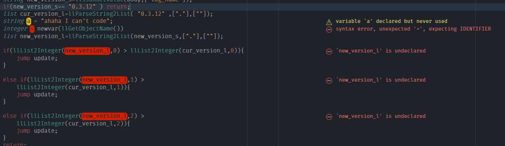

# SublimeLinter-contrib-lslint

This [SublimeLinter](https://github.com/SublimeLinter/SublimeLinter) plugin provides an interface to lslint.
This plugin applies linting to files that have the `lsl` and `ossl` syntax.
If you do not know what a linter is or are new to SublimeLinter, please refer to the [SublimeLinter documentation](http://www.sublimelinter.com/en/latest).

## SublimeLinter version

This version works with SublimeLinter 4 (tested with 4.30.1 on Sublime Text build 4200) and needs a syntax that defines the scopes `source.lsl` or `source.ossl`, for example the [LSL](https://packagecontrol.io/packages/LSL) package. The `lslint` binary is found on your PATH or in the `LSL` package folder.

It no longer works with SublimeLinter 3.

## Quick start

You're advised to install [Will Bond](https://wbond.net)'s [Package Control](https://packagecontrol.io) (see the [installation](https://packagecontrol.io/installation) page there) for [Sublime Text](https://www.sublimetext.com), which makes finding, installing and **keeping packages up-to-date** much easier.

### Requirements

* [Sublime Text](https://www.sublimetext.com)
* [SublimeLinter](https://packagecontrol.io/packages/SublimeLinter) 4

## Installation

In Sublime Text select from the menu `Tools > Command Palette` (see also [Command Palette](http://docs.sublimetext.info/en/sublime-text-3/extensibility/command_palette.html)), select `Package Control: Install Package` and hit <kbd>Enter ↩</kbd>, then select `SublimeLinter-contrib-lslint` and hit <kbd>Enter ↩</kbd>.

## Linter executable

`Sublimelinter-contrib-lslint` is developed for [makopo/lslint](https://github.com/makopo/lslint) and will probably not work with pclewis' original binary.

## Recommended plugins and settings

* Enable inline tooltips (Command Palette => SublimeLinter: Enable Inline Tooltips)
* Install `SublimeLinter Inline Errors` by `alexkuz` (Then disable `Show Errors on Save`!):
 (Optional, not for everyone)

## Contributing

Please see [`.github/CONTRIBUTING.md`](.github/CONTRIBUTING.md).

## Special thanks

* [@pclewis](https://github.com/pclewis) creating and/or providing lslint to the community
* [@makopo](https://github.com/makopo) for [makopo/sublime-text-lsl](https://github.com/makopo/sublime-text-lsl) and lslint improvements
* [@sei-lisa](https://github.com/Sei-Lisa) for coding help and LSL compiler experience
* [@buildersbrewery](https://github.com/buildersbrewery) for care, feeding and additional tips
